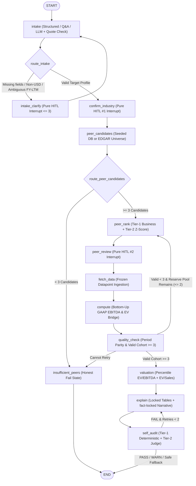

# Project Covenant AI (`covenant-ai`)

> **A deterministic financial valuation compiler wrapped by constrained LLM interfaces.**  
> Built for institutional **EV/EBITDA** comparable-company analysis of private businesses — enforcing US-GAAP accounting rigor, point-in-time market data parity, adversarial LLM hallucination containment, and an immutable PostgreSQL audit trail.

---

## Why This Architecture Exists

Most AI finance prototypes fail basic Investment Banking scrutiny for predictable structural reasons:

1. **LLMs perform arithmetic and drift:** Floating-point rounding errors and free-form model math silently corrupt valuation multiples and equity bridges.
2. **Apples-to-oranges accounting:** Mixing management-adjusted EBITDA with bottom-up GAAP EBITDA, or blending `LTM` and `FY` peer periods inside one cohort, invalidates comparisons before valuation even begins.
3. **US-GAAP XBRL & market-timing traps:** Naive EDGAR scrapers double-count capital leases and short-term investments, invert negated interest income/expense tags, mix filing accessions on composite D&A, or multiply stale cover share counts by look-ahead stock prices.
4. **Silent error suppression:** When extraction confidence is low, an audit fails, or peers are sparse, chatty agents paper over missing provenance instead of surfacing audit caveats.

**Project Covenant AI** inverts that paradigm. Every financial calculation runs inside a **zero-LLM `Decimal` computation engine** governed by explicit accounting invariants (`FIN-01` through `FIN-08`), while LLMs are confined strictly behind **two verifiable containment boundaries**: structured intake with verbatim quote verification, and `{{fact:...}}`-locked commentary gated by a two-tier self-audit.

---

## System Control Flow

`create_valuation_graph()` (`ai/src/covenant_ai/graph/workflow.py`) orchestrates **13 LangGraph nodes** across three human-in-the-loop (HITL) `interrupt()` checkpoints, bounded peer-pool backfill, and bounded narrative self-audit:



---

## Dual-Boundary Architectural Philosophy

Covenant AI enforces strict separation of concerns between **financial correctness** and **natural-language ergonomics**:

```text
┌──────────────────────────────────────────────────────────────────────────────┐
│  BOUNDARY 1: ADVERSARIAL LLM CONTAINMENT (covenant_ai/llm/)                  │
│  • Decimal-string schemas (zero float cast) & mandatory quote verification   │
│  • LockedFactPack ({{fact:...}} tokens) + Tier-1 stray-number ban            │
│  • Cross-model Tier-2 semantic audit with non-fatal deterministic fallback   │
└────────────────────────────────────┬─────────────────────────────────────────┘
                                     │ Validated Domain Models & Locked Facts
                                     ▼
┌──────────────────────────────────────────────────────────────────────────────┐
│  BOUNDARY 2: DETERMINISTIC FINANCIAL ENGINE (domain/ + providers/)           │
│  • Pure Python Decimal arithmetic (FIN-01) & R&P Exhibit 1.3 screening       │
│  • Bottom-up GAAP EBITDA vs owner-normalized private target schedule         │
│  • Point-in-time Market Cap + 5 US-GAAP XBRL disambiguation hierarchies      │
│  • Append-only PostgreSQL ledger with frozen run_id snapshots                │
└──────────────────────────────────────────────────────────────────────────────┘
```

### The Eight Financial Data Invariants (`FIN-01` – `FIN-08`)

| Invariant | Core Rule | Primary Enforcement Module |
| :--- | :--- | :--- |
| **`FIN-01`** | **Decimal Only & Zero-Arithmetic LLM:** Financial values parse as `Decimal(str(...))`; zero float arithmetic or prompt-level calculation. | `domain/models.py`, `llm/schemas.py`, `llm/fact_pack.py` |
| **`FIN-02`** | **Point-in-Time Market Cap:** Cover `EntityCommonStockSharesOutstanding` × exact `as_of_date` close (never `EntityPublicFloat`, never look-ahead prices; `<= 5` day prior session fallback strictly for verified non-trading holidays/weekends). | `providers/edgar.py`, `providers/market_calendar.py` |
| **`FIN-03`** | **GAAP Bottom-Up Peer EBITDA:** Peers strictly use `EBIT + D&A` (`EBIT = continuing ops + net interest + tax`); private normalization (`EbitdaAdjustmentSchedule`) applies only to the target. | `domain/bridge.py`, `domain/models.py`, `domain/intake.py` |
| **`FIN-04`** | **US-GAAP XBRL Disambiguation:** Negate credit-balance interest net tags, block cash/STI double-counts, use 5-tier debt/ASC 842 lease hierarchy, enforce accession parity & `/A` restatements. | `providers/edgar.py` |
| **`FIN-05`** | **Strict Period Parity & Rolling LTM:** Never mix `FY` and `LTM` peers in one valuation; `LTM = Latest_FY + Curr_YTD - Prior_YTD` requires verified cumulative YTD durations + MRQ balance sheet. | `domain/valuation.py`, `providers/edgar.py` |
| **`FIN-06`** | **Ledger Precedence & Run Freezing:** Resolution priority `USER_PROVIDED > SEC_FILING > MARKET_DATA`; baseline pool lives under `run_id IS NULL`, runs freeze snapshots under `run_id`, and empty DB industries return `[]` honestly. | `domain/selector.py`, `providers/postgres.py`, `providers/postgres_repo.py` |
| **`FIN-07`** | **No Hidden Errors:** Quote mismatches, clarifications, fallback narratives, audit warnings, and dropped peers are surfaced explicitly in reports and `audit_logs`. | `llm/audit_agent.py`, `llm/fact_pack.py`, `graph/nodes.py` |
| **`FIN-08`** | **Public Comp Quality Floor:** NYSE/Nasdaq/NYSE American/CBOE US Form `10-K` filers (`EV >= $100M`), excluding `20-F`/`40-F`, SPACs, warrants, and polite SEC rate-limit caching. | `domain/industry.py`, `providers/edgar.py`, `scripts/verify_peer_pool.py` |

---

## Financial & US-GAAP Accounting Engineering

### 1. Asymmetric Normalization (`FIN-03`)

Comparing a closely held private business to public corporations requires **asymmetric treatment**:

- **Public Peers (Zero Adjustments):** `domain/bridge.py` computes consolidated GAAP operating metrics bottom-up:
  $$\text{EBIT} = \text{Income from Continuing Operations} + \text{Interest Expense (Net)} + \text{Income Tax Expense}$$
  $$\text{EBITDA} = \text{EBIT} + \text{Depreciation \& Amortization}$$
  Management-defined "Adjusted EBITDA" is excluded by design so non-uniform stock-based compensation or restructuring add-backs do not skew multiples. `equity_method_income` is excluded from operating EBIT, while `preferred_equity` and `non_controlling_interests` sit in the Enterprise Value bridge (`EV = Market Cap + Total Debt + Preferred + NCI - Cash`), with `flag_peer()` raising an `nci_material` warning whenever `|NCI| / EV > 5%` (`NCI_MATERIALITY`) because EBITDA is 100% consolidated while NCI is carried at book value.
- **Private Target (`EbitdaAdjustmentSchedule`):** Private owner-managed adjustments (excess owner compensation, non-operating rent, verified one-time legal expenses, or one-time gains) live strictly inside `EbitdaAdjustmentSchedule` (`domain/models.py`). `from_line_items()` stores `non_recurring_income` as a positive magnitude (and signed `-abs(amount)` in the ledger) so `total_adjustments = owner_comp + discretionary + rent + non_recurring_charges - non_recurring_income` reduces `normalized_ebitda` for one-time gains, while preserving raw `reported_ebitda` alongside normalized EBITDA for banker review.

### 2. Five SEC EDGAR XBRL & Market-Timing Traps Solved (`FIN-04` & `FIN-02`)

Raw SEC `companyfacts` JSON routinely breaks naive extractors. `EdgarMarketDataProvider` (`providers/edgar.py`) resolves five specific failure modes:

1. **Credit-Sign Net Interest:** XBRL tags such as `InterestIncomeExpenseNet` and `InterestIncomeExpenseNonoperatingNet` carry positive sign when net interest is *income*; values are negated to expense-positive before entering `bridge.py`.
2. **Cash vs. Short-Term Investment Double-Count:** When cash resolves to `CashCashEquivalentsAndShortTermInvestments`, `ShortTermInvestments` is suppressed from summation.
3. **5-Tier Mutually Exclusive Debt + ASC 842 Leases (`_extract_total_debt`):** Traverses noncurrent long-term debt, combined long-term + capital-lease totals, and short-term/commercial paper hierarchies in strict exclusion order alongside split/combined operating and finance lease obligations so current maturities and capital leases are never counted twice.
4. **Accession Parity & `/A` Restatement Precedence:** Duplicate XBRL observations sort by `(filed, amendment_flag, accn)` descending, and composite `Depreciation + AmortizationOfIntangibleAssets` requires the exact same filing `accn`.
5. **Point-in-Time Cover Dates & Non-Trading Market Holidays (`market_calendar.py`):** Market cap multiplies filing-cover `EntityCommonStockSharesOutstanding` (never `EntityPublicFloat`) by the closing share price on the exact `shares_as_of` date. When a filing cover date falls on a US weekend or statutory NYSE holiday (verified against SPY trading-day tape or US market calendar rules), `_lookup_price_snapshot()` permits only the nearest prior trading session (`<= 5` calendar days earlier) tagged with `prior_trading_day_for_non_trading_cover_date=<shares_as_of>` and mandatory non-empty `source_ref`.

### 3. Rolling LTM Mechanics & Ledger Conflict Resolution

- **Rolling LTM (`FIN-05`):** Enforces exact duration validation (`Latest_FY + Curr_YTD - Prior_YTD` over true cumulative YTD periods, rejecting standalone ~90-day quarterly slices), paired with Most Recent Quarter (MRQ) Balance Sheet and MRQ cover shares (`10-Q`, or `10-K` when `10-K >= latest 10-Q`). `indicative_valuation()` raises `PeriodMismatchError` if any peer mixes `FY` and `LTM`.
- **Append-Only Priority (`domain/selector.py`):** Conflicting datapoints for `(ticker, metric, period)` resolve deterministically via `USER_PROVIDED (3) > SEC_FILING (2) > MARKET_DATA (1)`, then `period_end` descending, breaking ties on `retrieved_at` and recording a human-readable `SelectionResult.reason`.

---

## Institutional Screening & Valuation Mechanics

Following **Rosenbaum & Pearl, Ch. 1 (Comparable Companies Analysis, Exhibit 1.3)**, peer selection deliberately splits qualitative business comparability from quantitative scale/financial similarity (`domain/business_profile.py`, `domain/metrics.py`, `domain/screening.py`):

- **Tier 1 — Qualitative Business Profile Overlap (`BusinessDimension`):** Evaluates six dimensions — `sector` (+ `sub_industry`), `products_services`, direct `customers`, ultimate `end_markets` (explicitly split per R&P guidance), `distribution_channels`, and `geography`. Uses active-axis Jaccard similarity (`business_overlap`) over populated dimensions on both sides so missing optional tags never dilute a peer's score.
- **Tier 2 — Weighted Z-Score Financial Distance (`FEATURE_WEIGHTS`):** Computes normalized Euclidean distance across available financial ratios (`fin_score = 1 / (1 + sqrt(sq_dist / active_weight))`):
  - `log_revenue`: `0.35` *(log-scale revenue proximity)*
  - `ebitda_margin`: `0.20`
  - `revenue_growth_yoy`: `0.20`
  - `net_debt_to_ebitda`: `0.15`
  - `gross_margin`: `0.05`
  - `capex_to_revenue`: `0.05`
- **30/70 Blend & Unscorable Penalty:** When qualitative tags participate, peers rank by `0.30 * biz_score + 0.70 * effective_fin`. Candidates missing quantitative metrics when peers are scorable receive `effective_fin = 0.0`, sorting strictly behind verified comps.
- **Outlier & Capital-Structure Transparency (`domain/valuation.py`):**
  - Requires `MIN_PEERS = 3` (adding a sample-size caveat below `RECOMMENDED_PEERS = 5`).
  - Flags multiples outside Tukey fences `[Q1 - 1.5*IQR, Q3 + 1.5*IQR]` and `[P25, P75]` without silent deletion.
  - Applies an economic equity floor `max(0, EV - (Target Debt - Target Cash))` and surfaces distressed/high-leverage warnings when net debt exceeds implied EV.
  - **No Synthetic Discounts:** `build_lmm_size_spread_note()` explicitly highlights scale spread whenever `implied_ev_mid < $100M` or `< min(peer_ev) / 5` rather than applying opaque, hard-coded private-company size haircuts.
  - Computes a secondary **EV/Sales** cross-check whenever target revenue `> 0` and `>= 3` peers report positive revenue.

---

## Adversarial LLM Containment & LangGraph HITL Design

Rather than trusting prompt instructions to prevent hallucination, `covenant_ai/llm/` surrounds every LLM invocation with structural guardrails:

1. **Zero-Float Extraction & Quote Provenance (`intake_agent.py`, `schemas.py`):**
   - Extracted dollar figures arrive as strings and validate strictly into `Decimal`.
   - Non-USD currencies route immediately to `intake_clarify` rather than attempting speculative FX conversion.
   - Missing `FY`/`LTM` basis refuses silent `FY` defaults, forcing user clarification instead.
   - User clarification answers lock fields (`locked_intake_fields`) so re-running extraction never overwrites explicit human corrections.
   - Inferred classifications (`FieldInference`) validate exact substring match via `verify_quote_in_source()`. Unverified or omitted provenance records an explicit inconsistency note instead of failing silently.
2. **`{{fact:...}}` Placeholder Synthesis (`fact_pack.py`, `narrative_agent.py`):**
   - `build_fact_pack()` pre-computes every formatted dollar figure, multiple, spread (`margin_spread_pct`), directional tag (`margin_spread_direction`), EV/Sales divergence, and LMM scale ratio in pure Python.
   - The narrative LLM authors prose around `{{fact:...}}` placeholders only; Python performs deterministic final substitution.
3. **Two-Tier Self-Audit & Safe Fallback (`audit_agent.py`):**
   - **Tier 1 (Deterministic Regex & Logic Gates):** Fails any unresolved `{{` / `}}`, unknown `{{fact:...}}` keys, **any raw numeric token outside placeholders** (`_check_stray_numbers`, whitelisting domain terms like `P25`, `10-K`, `ASC 842`), margin direction contradictions (`above` vs `below`), `FY`/`LTM` basis mismatches, omitted mandatory risk disclosures (`customer_concentration`, `high_leverage_distressed`, `lmm_size_spread`, recorded inconsistencies), or banned claims (e.g., synthetic `20%` liquidity discounts or buy/sell advice).
   - **Tier 2 (Cross-Model Semantic Audit):** Runs under the lightweight model role inside isolated `try/except`; API/network failures emit `AuditVerdict.WARN` (`semantic_audit_unavailable`) without crashing a completed valuation.
   - Exhausting `MAX_AUDIT_RETRIES = 2` falls back gracefully to deterministic institutional commentary and records the fallback transparently under `#### Audit Status & Disclosed Process Inconsistencies`.
4. **Hardened LangGraph Workflow & HITL Purity (`graph/nodes.py`, `graph/checkpointer.py`):**
   - All three interactive `interrupt()` nodes (`intake_clarify`, `confirm_industry`, `peer_review`) execute **zero LLM or provider calls** because LangGraph replays interrupted nodes from their entry point upon `--resume`.
   - Industry overrides at `confirm_industry` resync `CompanyProfile` immediately in workflow state (recording an explicit update note), and `cli.py` detects profile drift to append a new versioned `company_profiles` row in PostgreSQL and re-link `analysis_runs.profile_id`.
   - `PostgresSaver` uses an explicit `COVENANT_MSGPACK_ALLOWLIST` restricting checkpoint deserialization to vetted Covenant domain types.
   - `LLMConfig` reads `.env` for 2-tier routing (`COVENANT_FAST_MODEL` for extraction/semantic audit vs. `COVENANT_WRITER_MODEL` for commentary, or single-model `COVENANT_LLM_MODEL`), while `LLMInterceptor` (`before_call` / `after_call`) provides a clean security seam for future MNPI redaction or compliance logging.

---

## Persistence Architecture & Deliberate Scope Boundaries

### Relational Audit Model (`db/init.sql` & `postgres_repo.py`)

- **Immutable Run Snapshots vs. Living Baseline (`FIN-06`):** Reference datapoints from curated verification live under `financial_datapoints.run_id IS NULL`. Each analysis run freezes its exact selected inputs under `run_id` alongside `valuation_results` (`explanation_md`, `narrative_md`, `audit_verdict`, `audit_findings`, `prompt_version`) and append-only `audit_logs` — ensuring later EDGAR updates never retroactively alter past runs.
- **Decoupled Screening Audit (`peer_candidates`):** Deliberately omits a cascading foreign key to mutable `peer_companies` so historical rank scores (`total_score`, `business_score`, `financial_score`, `size_distance`, `drop_reason`) remain inspectable even if tickers delist or leave the active pool.
- **Honest Empty-Pool Semantics:** When PostgreSQL is reachable and seeded, querying an industry with zero active verified peers returns `[]` cleanly rather than masking missing coverage with silent live network scraping (EDGAR fallback runs only when the database is unreachable or unseeded).

### Supported Industry Scope & Deliberate Exclusions (`domain/industry.py`)

Covenant AI targets **10 SIC-verified US Form `10-K` sectors** (`MIN_VERIFIED_PEERS = 8` pool floor): `application_software`, `it_services`, `packaged_foods`, `restaurants`, `apparel_footwear`, `logistics_freight`, `industrial_machinery`, `building_products`, `electronic_manufacturing`, and `commercial_services`. Capital-structure-incompatible sectors (**banks/insurance/REITs**, **pre-revenue biotech**, **commodity mining/oil & gas**, **regulated utilities**, and catch-all **SIC 7389**) are intentionally excluded.

### Deliberate Non-Goals (Current Release)

- Single methodology focus (**EV/EBITDA** with secondary **EV/Sales** cross-check); DCF and Precedent M&A Transactions are out of current scope.
- Strict **USD-only** target inputs; automated multi-currency FX translation is intentionally rejected cleanly at intake.
- CLI & Python workflow focus; Web/Admin CRUD REST endpoints, PDF/CIM OCR ingestion, and Redis queue integration are planned future layers (`workflow.py` defaults to `MemorySaver` unless an explicit checkpointer is injected by CLI/host).

---

## Project Structure

```text
projectCovenant/
├── docker-compose.yml                  # PostgreSQL (pgvector:pg16), optional Redis, Adminer
├── .env.example                        # Environment template (copy to .env)
├── db/
│   └── init.sql                        # Relational audit ledger, peer_candidates & snapshot schema
└── ai/
    ├── pyproject.toml                  # Build metadata, pytest config, `covenant` console script
    ├── requirements.txt                # Pinned Python dependencies
    ├── market_price_snapshots.example.csv
    ├── src/covenant_ai/
    │   ├── cli.py                      # Interactive / JSON / --prompt / --resume CLI runner
    │   ├── peer_verification.json      # Curated SEC/market peer universe metadata
    │   ├── domain/                     # Pure Decimal math, R&P screening, ledger selector, models
    │   ├── graph/                      # 13-node StateGraph, pure HITL interrupts, allowlisted checkpointer
    │   ├── llm/                        # LLMClient/LLMInterceptor, Gemini & Fake adapters, FactPack, self-audit
    │   ├── providers/                  # EDGAR XBRL/calendar engine, PostgresCaseRepository, FakeProvider
    │   ├── scripts/                    # discover_peers, curate_peers, verify_peer_pool, seed_db
    │   └── tools/                      # adapters, calc, envelope, fetch
    └── tests/                          # Mirrored pytest suite (domain, graph, llm, providers, tools)
```

---

## Quickstart & CLI Usage

### 1. Configure Environment (`.env`)

Copy `.env.example` to `.env` at the repository root (`.env` is gitignored):

```powershell
Copy-Item .env.example .env
```

Environment variables:
- `DATABASE_URL` / `LANGGRAPH_CHECKPOINTER_URI`: PostgreSQL connection URIs.
- `SEC_USER_AGENT`: Required by SEC EDGAR Fair Access policy (`YourName your-email@example.com`).
- `GEMINI_API_KEY` *(optional)*: Enables live `GeminiClient` for `--prompt` intake and `llm_hybrid` narrative drafting. Omit for offline deterministic execution.
- `COVENANT_FAST_MODEL`, `COVENANT_WRITER_MODEL`, `COVENANT_LLM_MODEL` *(optional)*: Configure local model IDs via `.env` without checking model config into source control.
- `COVENANT_DISABLE_LLM=1` *(optional)*: Forces deterministic execution even when `GEMINI_API_KEY` is present.

### 2. Start PostgreSQL, Install & Seed

```powershell
docker compose up -d postgres

cd ai
python -m venv .venv
.\.venv\Scripts\Activate.ps1
pip install -r requirements.txt
pip install -e .

# Seed baseline peer universe into PostgreSQL
python -m covenant_ai.scripts.seed_db
```

### 3. Run the Valuation CLI

```powershell
# Interactive QUESTION_BANK wizard
python -m covenant_ai.cli

# Structured JSON target intake
python -m covenant_ai.cli --input path/to/intake.json --export-md report.md --export-json result.json

# Natural-language intake (requires GEMINI_API_KEY in local .env)
python -m covenant_ai.cli --prompt "Acme Software provides B2B SaaS in the US. FY2025 revenue $18M, reported EBITDA $2.7M, $200k excess owner salary." --export-md report.md --export-json result.json

# Pause at HITL checkpoint and resume cleanly across processes
python -m covenant_ai.cli --input path/to/intake.json --thread-id deal-001 --pause-after-intake
python -m covenant_ai.cli --resume deal-001
```

Available flags (`python -m covenant_ai.cli --help`):  
`--input`, `--prompt`, `--explain-mode {llm_hybrid,deterministic}`, `--resume`, `--thread-id`, `--db-url`, `--auto-approve`, `--pause-after-intake`, `--export-md`, `--export-json`.

---

## Testing

Run tests from the `ai/` directory:

```powershell
cd ai
.\.venv\Scripts\python.exe -m pytest -q --tb=short
```

Unit suites (`tests/domain/`, `tests/tools/`, `tests/llm/`, and memory-checkpointer workflow tests in `tests/graph/`) run **fully offline** via `FakeProvider` and `FakeLLMClient`. Database integration tests (`tests/providers/test_postgres*.py`, CLI/intake Postgres integration tests) require PostgreSQL running (`docker compose up -d postgres`) with baseline data seeded.
