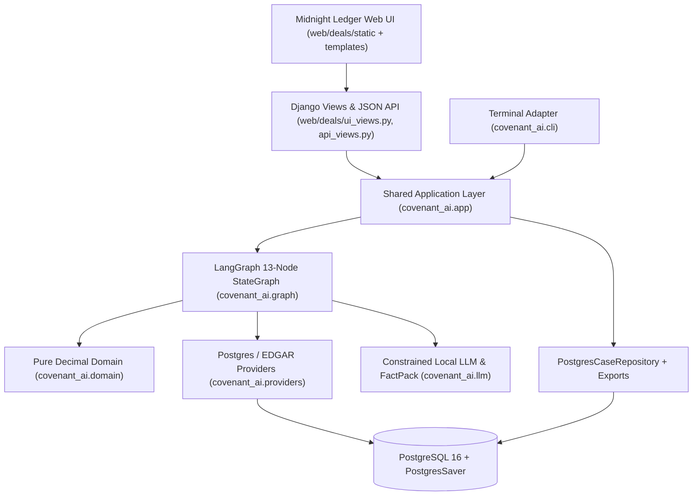
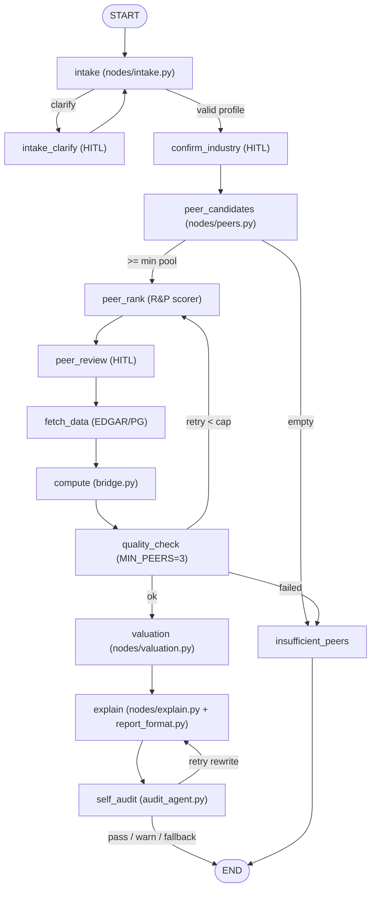

# Architecture

> Monorepo split cleanly across **pure domain math**, **durable LangGraph orchestration**, a **shared application layer**, **SEC EDGAR/PostgreSQL market ingestion**, and the **Midnight Ledger Django workspace**.

[Product](./product.md) | [Reference](./reference.md) | [Ops](./ops.md) | [Eval & QA](./eval.md) | [Integrity Spec](./financial-data-integrity.md) | [ERD](./covenant-erd.mmd)

**Goals:** `Decimal`-only financial math isolated from I/O; CLI and Web parity over one service layer; crash-safe HITL resume; SHA-256 frozen audit artifacts; local-only processing of private deal inputs.  
**Non-goals:** Microservices split across `ai/` and `web/`; LLM-computed multiples; silent metric fabrication.

## System Layers

## Key Architectural Decisions

| Decision | Rationale |
| :--- | :--- |
| **Shared `covenant_ai.app` Layer** | Terminal CLI and Django endpoints share `CaseService`, `ValuationRunnerService`, `ChatService`, `ReviewService`, `AdminIdentityService`, `exports.py`, and `authz.py` behind PostgreSQL advisory locks (`thread_lock`). |
| **Migration Ownership Split** | `db/init.sql` + idempotent `db_schema.ensure_domain_schema()` own domain/audit tables; Django migrations manage only `auth_*`, `django_*`, sessions, and the custom `deals.release` permission. |
| **1:1 User Linking (`django_user_id`)** | Django `auth_user` links cleanly to `public.users(id UUID)` without breaking legacy `owner_id` / `actor_id` foreign keys; unverified legacy users remain blocked until explicit activation. |
| **Two Persistence Planes** | **LangGraph checkpoints** (`PostgresSaver` + `COVENANT_MSGPACK_ALLOWLIST`) track execution resumption; **frozen `review_packet` JSONB** (`SHA-256` digest) + **`run_commands`** deduplicate requests and preserve exact snapshot provenance (`origin_id`). |
| **Local-First LLM Guard (`FIN-01`)** | `LLMConfig` routes tasks by `LLMWorkload` (`fast_interactive` `25s` vs `writer_longform` `60s`) over `GeminiClient` / `LocalShowcaseLLMClient` / `FakeLLMClient`; `require_local_client()` enforces `local_only=True` and deterministic `FactPack` verification gates every LLM draft. |
| **Same-Origin Midnight Ledger UI** | Vanilla ES modules + CSS token sheets (no bundler build step), `Dark` / `Light` theme toggle, custom SVG Valuation Football Field & Cohort Bar Chart (`charts.js`), 5-stage progress trace strip, and frozen pitchbook canvas. |

## LangGraph Workflow (`graph/workflow.py`)

`CaseGraph` guards existing thread checkpoints and compiles **13 nodes** across five focused subpackage modules under `ai/src/covenant_ai/graph/nodes/`:

## Restructured Module Map

### `ai/src/covenant_ai/`

| Package | Modules & Responsibility |
| :--- | :--- |
| **`domain/`** | `models.py`, `amounts.py`, `bridge.py` (GAAP EBIT/EBITDA + filing date), `business_profile.py`, `evidence.py`, `industry.py`, `intake.py`, `intake_questions.py`, `metrics.py`, `screening.py`, `selector.py`, `valuation.py` (Tukey outliers, sensitivity, comparability, extensible bridge), `errors.py`. |
| **`graph/`** | `workflow.py`, `state.py`, `checkpointer.py`, `nodes/__init__.py`, `nodes/intake.py`, `nodes/peers.py`, `nodes/valuation.py`, `nodes/report_format.py`, `nodes/explain.py`. |
| **`llm/`** | `client.py` (`LLMConfig`, `LLMWorkload`, `LLMInterceptor`, error taxonomy), `gemini.py`, `local_demo.py`, `fake.py`, `fact_pack.py`, `schemas.py`, `intake_agent.py`, `narrative_agent.py`, `audit_agent.py`, and `prompts/{shared,intake,explain,audit}.py`. |
| **`providers/`** | `edgar_client.py` (HTTP + `.edgar_cache` + rate limits), `xbrl_reader.py`, `price_store.py`, `datapoint_builder.py`, `edgar.py` (`EdgarMarketDataProvider`), `edgar_manifest.py` (`collect`/`offline`/`replay`), `edgar_tags.py`, `edgar_errors.py`, `market_calendar.py`, `postgres.py`, `postgres_repo.py`, `db_schema.py`, `reviewer.py`, `fake.py`. |
| **`app/`** | `authz.py`, `cases.py`, `runs.py`, `chat.py` (trace steps + idempotent prompt handling), `reviews.py`, `exports.py` (`md`/`json`/`xlsx`), `admin.py`, `errors.py`. |
| **`eval/` & `scripts/`** | `eval/probe_runner.py`, `eval/report.py`, `eval/cases/*.json`; scripts `seed_db.py`, `compare_edgar_methods.py`, `discover_peers.py`, `verify_peer_pool.py`, `curate_peers.py`. |

### `web/deals/`

| Layer | Files |
| :--- | :--- |
| **Views & Auth** | `ui_views.py` (Django SSR pages), `api_views.py` (REST handlers), `auth_service.py` (RBAC actor resolution + activation), `management/commands/seed_demo.py`. |
| **Templates** | `templates/deals/{base,login,case_list,case_detail,review_queue,admin_console}.html`. |
| **Midnight Ledger Styles** | `static/deals/styles/{tokens,layout,components}.css` + `static/deals/app.css`. |
| **Vanilla ES Modules** | `static/deals/app.js` + `static/deals/modules/{api,theme,markdown,charts,chat-studio,report-canvas}.js`. |
